# LoopBack

> **Private, On-Device, Multi-Vertical AI Productivity & Professional Practice Platform**  
> *Sellable Enterprise Product · Proprietary & Confidential · Bring Your Own AI (BYOK)*

---

## Executive Overview

**LoopBack** is a local-first, privacy-engineered multi-vertical productivity platform. Built on the non-negotiable rule of **Zero Data Leakage**, LoopBack empowers professionals and academic researchers to deploy state-of-the-art AI without surrendering proprietary client records, confidential legal briefs, or intellectual assets to third-party cloud aggregators.

LoopBack operates as a unified platform serving **three specialized vertical heads**, each customized with bespoke domain engines, design tokens, statutory calendars, and specialized workflows:

1. **Student & Academic Head (`http://localhost:3010`)**: Active Recall, Concept Evaluation, Dual Memory (Working + Semantic), Workspace-Scoped RAG, and Learning Analytics.
2. **Chartered Accountant & Tax Advisory Head (`http://localhost:3020`)**: Statutory Compliance Pipelines (GST, Income Tax, ROC), Companies Act 2013 Schedule III Ratio Variance Engine (>25% statutory alert), CARO 2020 & Form 3CD Audit Verification Workpapers.
3. **Law Chambers & Litigation Practice Head (`http://localhost:3030`)**: Limitation Act 1963 Calculator (Section 18 acknowledgment tolling & Section 5 condonation rules), Supreme Court & High Court Cause List Tracker, Landmark Case Precedents Repository, and Procedural Litigation Scheduling.

---

## Platform Visual Showcase (Real Screenshots)

### 1. Student & Academic Vertical (Port 3010)

| Academic Cockpit & Study Dashboard | Active Recall & Document Knowledge Studio |
| :---: | :---: |
| 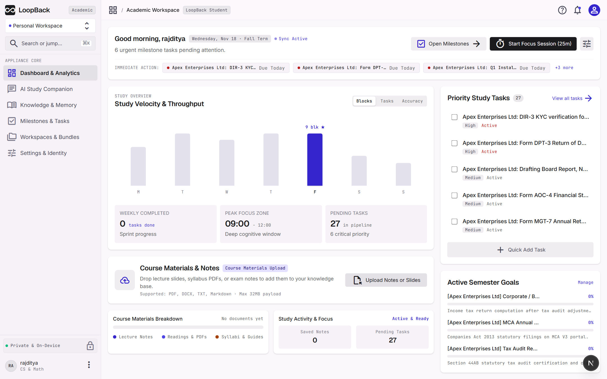 | 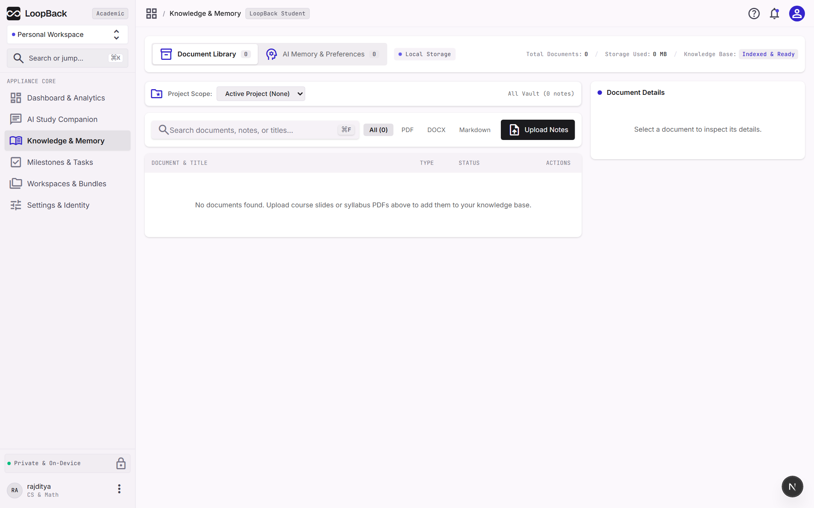 |
| *Personalized academic progress, task milestones, study streaks, and workspace navigation.* | *Document ingestion, multi-modal PDF extraction, and active recall evaluation sessions.* |

| AI Study Copilot & Memory Stream |
| :---: |
| 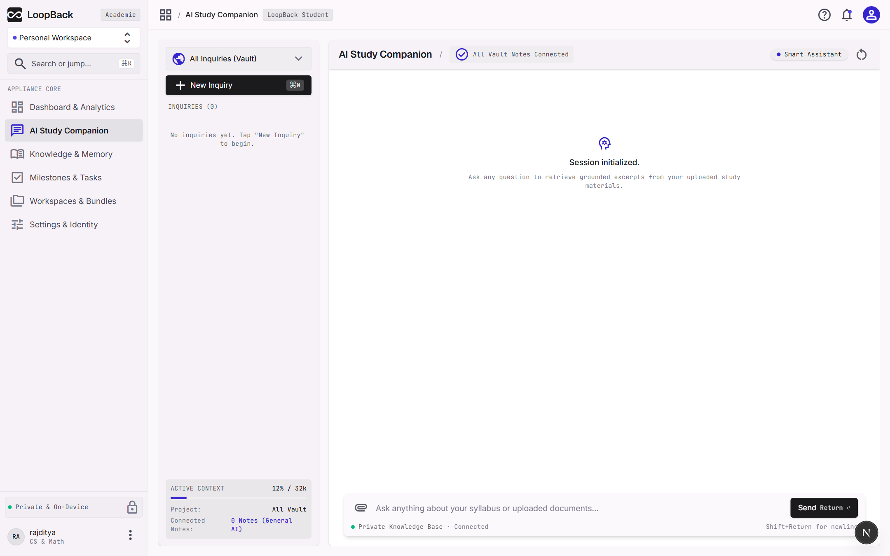 |
| *Streaming conversational assistant with persistent episodic memory and workspace document RAG.* |

---

### 2. Chartered Accountant & Tax Advisory Vertical (Port 3020)

| CA Practice Management & Statutory Pipeline | Schedule III Ratio Variance Engine |
| :---: | :---: |
| 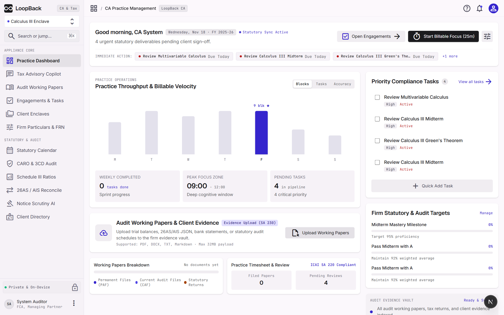 | 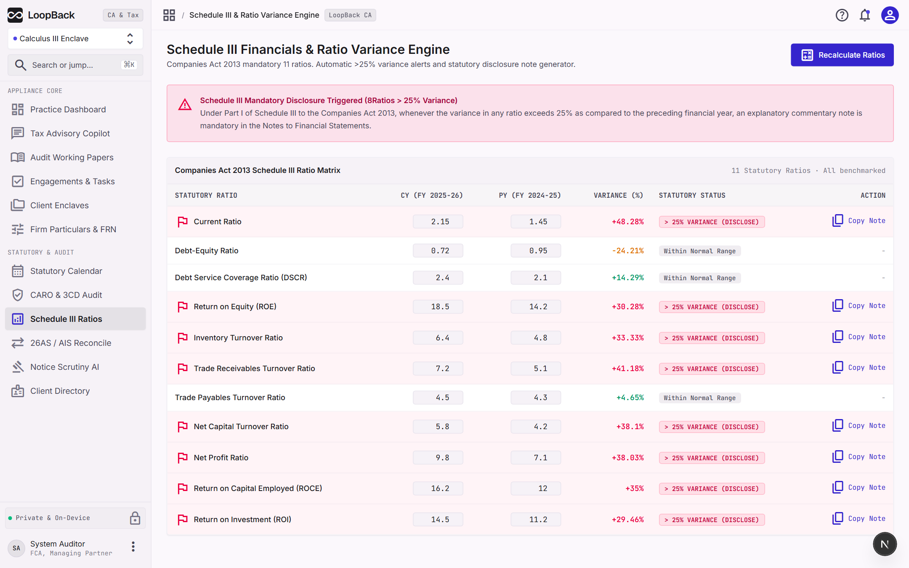 |
| *Statutory compliance calendar (Form 3CD, CARO, 26AS/AIS), client enclaves, and firm billings.* | *Companies Act 2013 mandatory 11 ratios with automated >25% variance alerts and statutory notes.* |

| CARO 2020 & Form 3CD Audit Verification Suite |
| :---: |
| 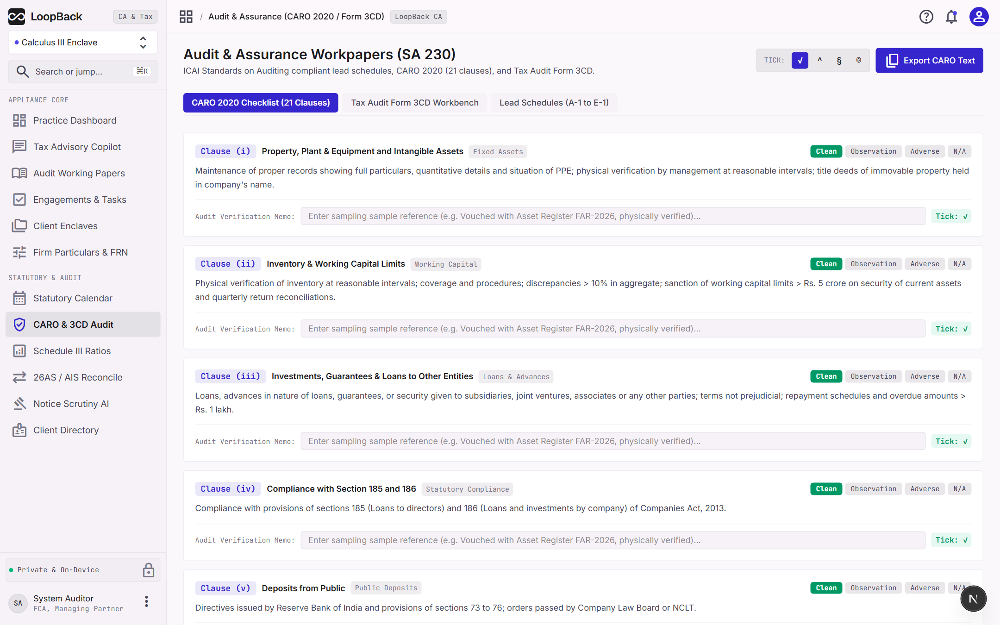 |
| *Structured 21-clause CARO 2020 verification checklist, Form 3CD tax audit clauses, and tickmarks.* |

---

### 3. Law Chambers & Litigation Practice Vertical (Port 3030)

| Litigation Chambers Cockpit & Hearing Tracker | Limitation Act 1963 Period Calculator |
| :---: | :---: |
| 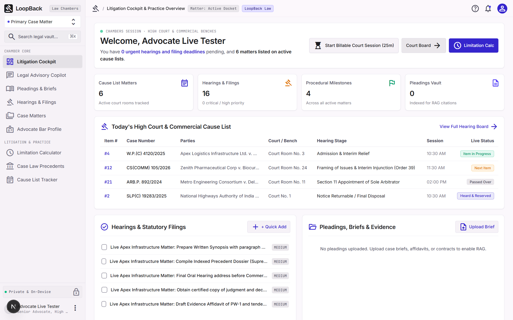 | 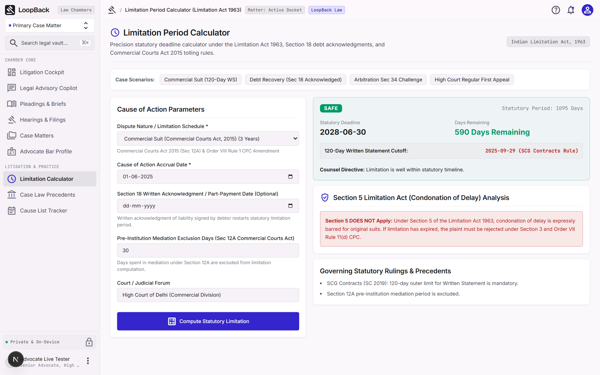 |
| *Daily cause list tracking, active court dockets, limitation urgency counters, and case enclaves.* | *Statutory limitation computation, Section 18 written acknowledgment tolling, and Order VIII Rule 1 ceilings.* |

| Daily Court Cause List Tracker | Landmark Case Precedents Repository |
| :---: | :---: |
| 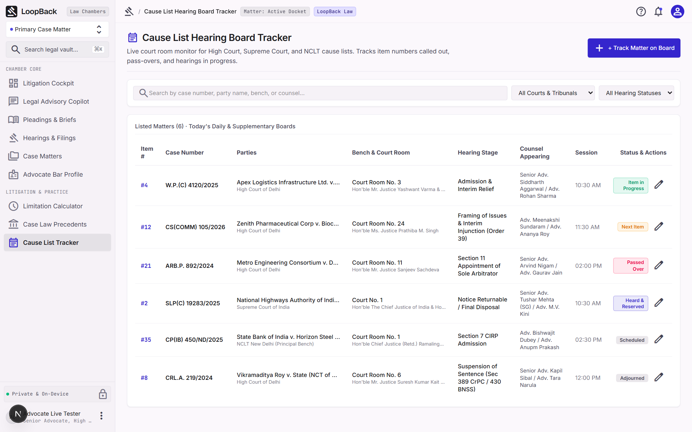 | 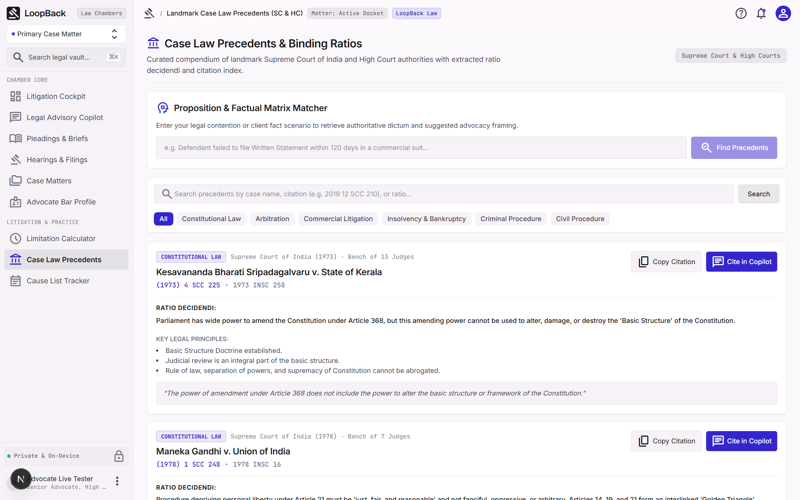 |
| *Live courtroom stage monitoring, item sequence tracking, and advocate roster management.* | *Searchable landmark judgments, headnote indexing, bench ratios, and proposition matching.* |

---

## Core Product Capabilities

- **Bring Your Own AI (BYOK)**: Connect private API keys for **OpenAI** (`gpt-4o`, `o3-mini`), **Google Gemini** (`gemini-2.5-flash`), **Anthropic Claude** (`claude-sonnet-4`), **xAI Grok** (`grok-4`), or **Kimi** (`moonshot-v1`).
- **Zero Third-Party Storage**: Credentials and documents are stored strictly in local encrypted SQLite and on-device ChromaDB vector collections.
- **Enterprise Multi-Enclave Isolation**: Workspaces, client folders, and case matters are physically partitioned with foreign key integrity.
- **Auditable Statutory Intelligence**: Rule-based engines enforce statutory standards (Limitation Act 1963, Companies Act 2013 Schedule III, Income Tax Act 1961) client-side and server-side with zero hallucinations.

---

## System Architecture

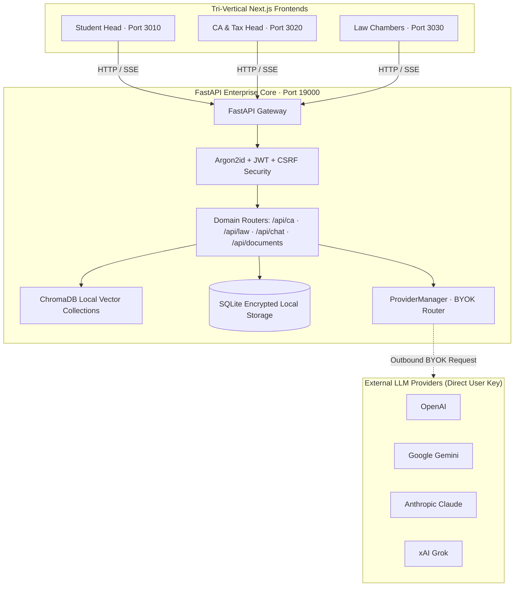

---

## Port Allocation Matrix

| Service | Port | Target Persona | Key Feature Set |
| :--- | :--- | :--- | :--- |
| **FastAPI Core Backend** | `19000` | Platform Core | Unified REST API, ChromaDB vector store, SQLite persistence, SSE streaming |
| **Student Frontend** | `3010` | Students & Researchers | Active recall, revision schedules, memory profiler, workspace documents |
| **CA Frontend** | `3020` | Chartered Accountants & Tax | Statutory calendar, Schedule III ratios, CARO 2020 / 3CD audit checklists |
| **Law Frontend** | `3030` | Advocates & Law Chambers | Limitation calculator (Sec 18 tolling), Cause list tracker, Case precedents |

---

## Quick Start & Installation

### Prerequisites
- **Python 3.11+**
- **Node.js 20+** (LTS recommended)
- **API Key** for at least one supported provider (OpenAI, Gemini, Anthropic, Grok, or Kimi)

### 1. Unified Launcher (Recommended)
```powershell
.\run.bat
```
The launcher initializes the Python virtual environment (`backend/.venv`), installs dependencies, runs database migrations, sets environment variables, and starts both the backend (`19000`) and the frontends.

### 2. Manual Independent Startup

```powershell
# 1. Start Core Backend
cd backend
.\.venv\Scripts\python.exe run_dev.py

# 2. Start Student Head
cd frontend
npm run dev # Runs on port 3010

# 3. Start CA Head
cd ca_frontend
npm run dev # Runs on port 3020

# 4. Start Law Head
cd law_frontend
npm run dev # Runs on port 3030
```

---

## Verification & Test Suites

The backend and all frontends are verified by automated test suites:

```powershell
# Backend pytest suite (71 passing tests across Core, CA, and Law domains)
cd backend
.\.venv\Scripts\pytest.exe -o pythonpath=. tests/ -q

# Frontend production builds
cd frontend && npm run build
cd ../ca_frontend && npm run build
cd ../law_frontend && npm run build
```

---

## License & Proprietary Terms

**PROPRIETARY AND CONFIDENTIAL**

Copyright © 2026 Rajditya Patel / LoopBack. All rights reserved.

LoopBack is proprietary commercial intellectual property. Unauthorized copying, reverse engineering, redistribution, sublicensing, decompilation, public display, or commercial exploitation of this software, its domain algorithms, design systems, or source code is strictly prohibited.

For commercial licensing and enterprise deployment inquiries, refer to [LICENSE](LICENSE).
