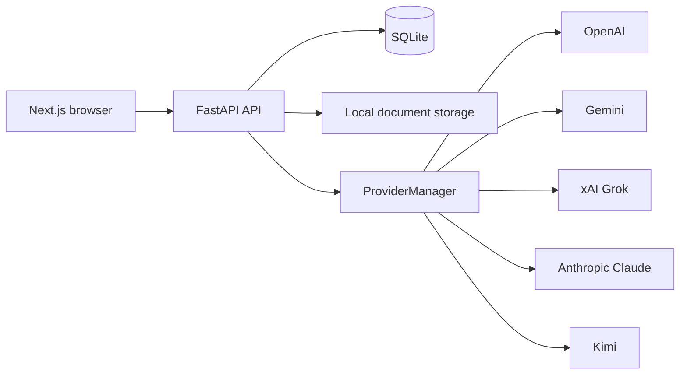
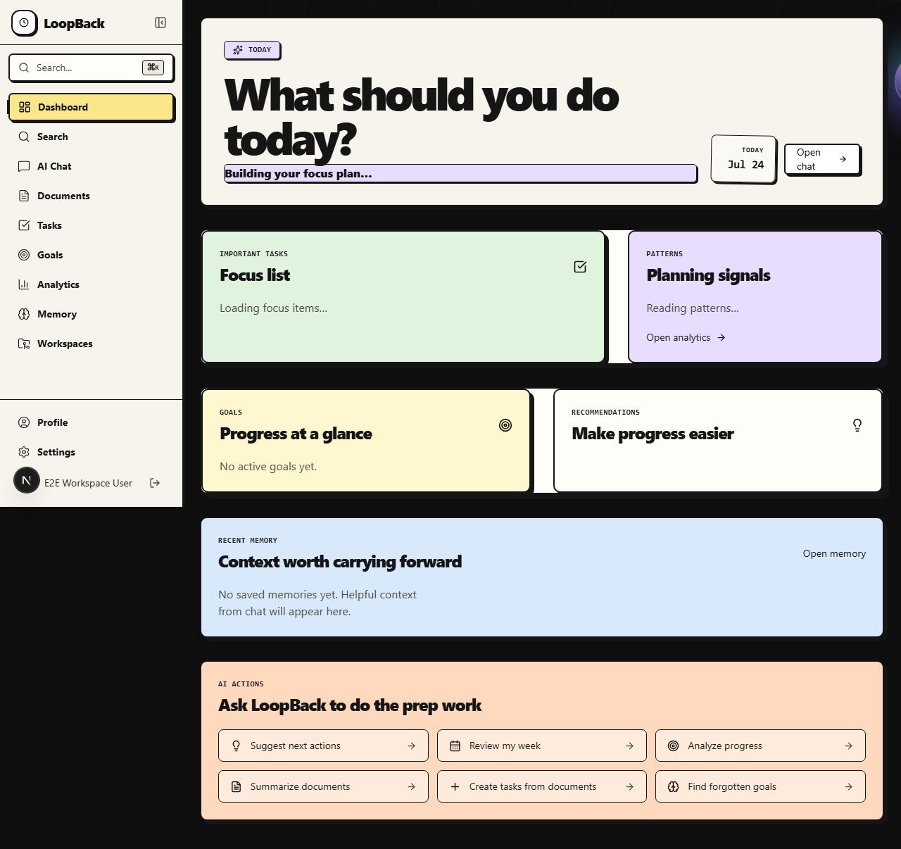
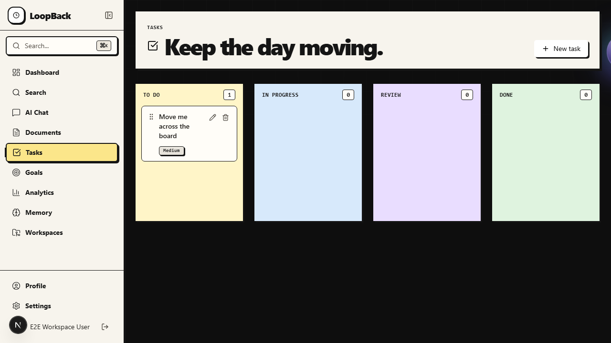
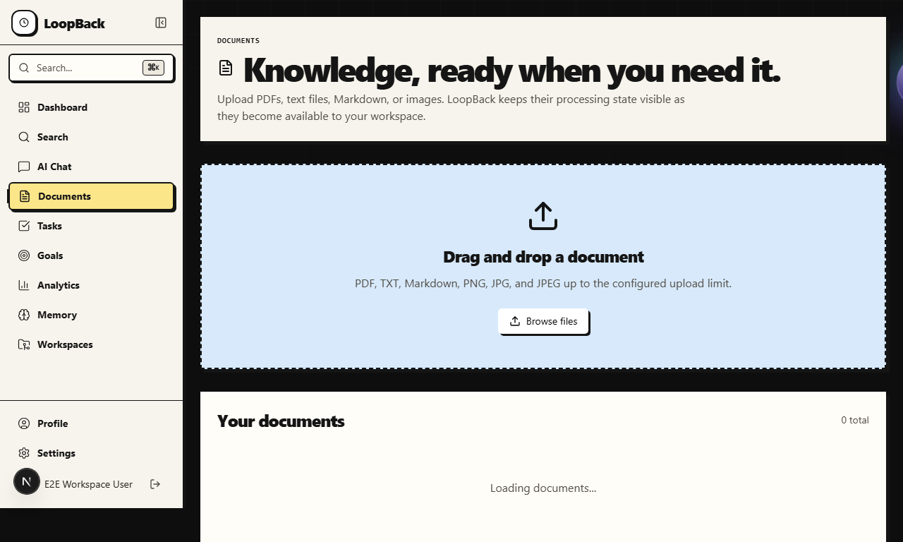
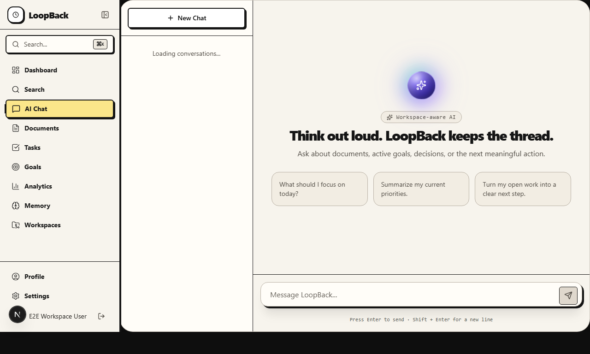

# LoopBack

LoopBack is a local-first, open-source productivity workspace built around a simple rule: **Bring Your Own AI**. Your documents, workspaces, learning history, provider choice, and API key stay under your control.

## Highlights

- Bring your own OpenAI, Gemini, xAI (Grok), Anthropic Claude, or Kimi API key.
- Configure provider, model, temperature, and streaming per account in AI Configuration Center.
- Chat with workspace-aware document retrieval and streamed responses.
- Upload PDFs, images, TXT, and Markdown files for local extraction and retrieval.
- Learn actively: study a document, explain it in your own words, and receive specific AI feedback.
- Track a persistent knowledge profile: scores, strengths, misconceptions, weak topics, revision needs, and learning streaks.
- Use local SQLite storage, FastAPI, Next.js, and Alembic migrations.

## Quick start

Prerequisites: Python 3.11+, Node.js 20+, and an API key for one supported provider.

```powershell
git clone <your-new-LoopBack-OpenSource-repository>
cd LoopBack-OpenSource
.\run.bat
```

The launcher installs dependencies, creates local configuration, starts the API and frontend, and prints the local URLs. Register an account, then open **Settings → AI Configuration Center** to save and test your own provider key.

## Supported providers

| Provider | Suggested starter model |
| --- | --- |
| OpenAI | `gpt-4o-mini` |
| Google Gemini | `gemini-2.5-flash` |
| xAI Grok | `grok-4` |
| Anthropic Claude | `claude-sonnet-4-20250514` |
| Kimi | `moonshot-v1-8k` |

No provider API keys are committed to this repository. Keys are submitted only to the authenticated backend, are never returned in API responses, and are used only for that account's requests.

## Architecture



The provider abstraction ensures chat and learning evaluation use the same account-selected provider without a server restart. See [architecture documentation](docs/ARCHITECTURE.md) for data flow and migration guidance.

## Document learning workflow

1. Upload a document.
2. Choose **Start active recall** on the document page.
3. Explain the topic in your own words.
4. LoopBack evaluates accuracy, score, missing concepts, misconceptions, strengths, follow-up questions, difficulty, and revision recommendations.
5. Review the knowledge profile to guide the next study session.

## Screenshots

| Dashboard | Tasks |
| --- | --- |
|  |  |

| Documents | Chat |
| --- | --- |
|  |  |

## Development

```powershell
cd backend
.\.venv\Scripts\python.exe -m pytest -q
.\.venv\Scripts\alembic.exe upgrade head

cd ..\frontend
npm run build
```

The backend does not run migrations automatically on startup. Apply them deliberately before deploying.

## Environment

`backend/.env.example` contains non-secret runtime settings. Set a unique `LOOPBACK_JWT_SECRET_KEY` before starting the API. AI credentials are intentionally not configured through repository environment files; configure them after login in AI Configuration Center.

## Contributing

See [CONTRIBUTING.md](CONTRIBUTING.md). Please add tests for behavior changes, avoid provider-specific logic outside `ProviderManager`, and never commit credentials, local databases, or uploads.

## Roadmap

See [roadmap.md](roadmap.md). Potential version 2 work includes encrypted local key storage, spaced-repetition queues, provider-native streaming adapters, and exportable learning reports.

## License

LoopBack is released under the [MIT License](LICENSE).
