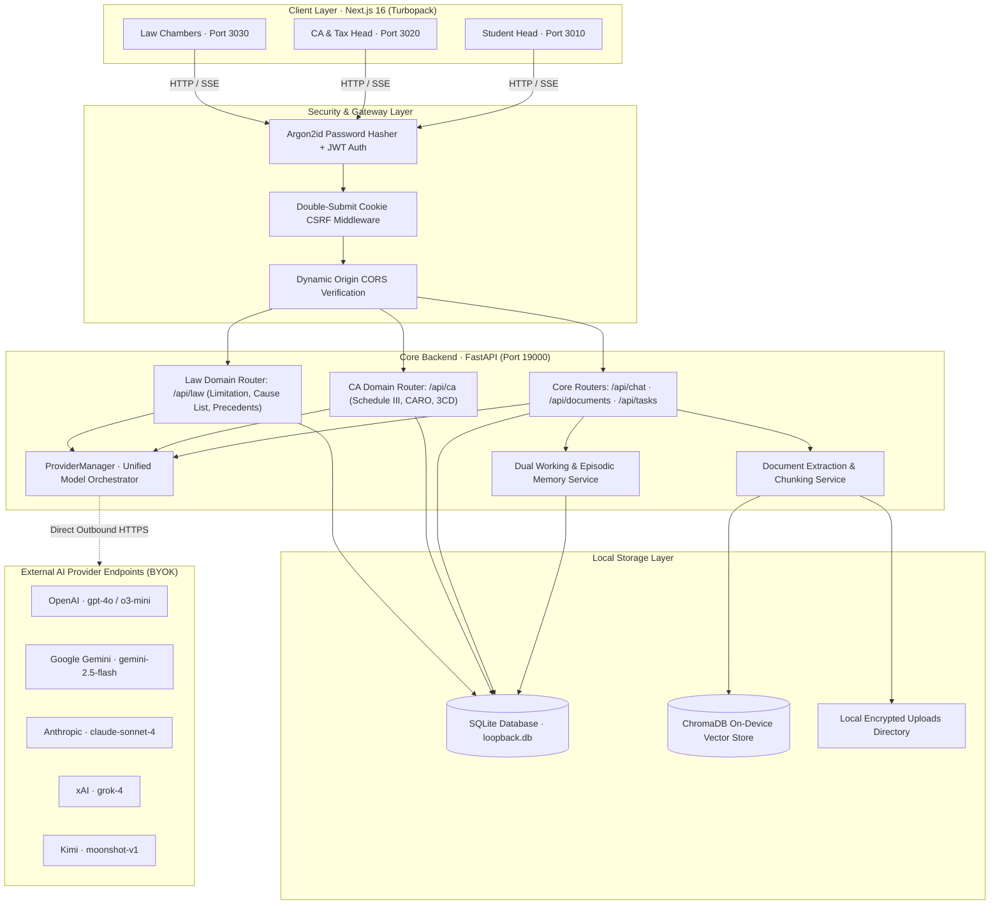

# LoopBack Architecture & System Design

> **Technical Architecture of the LoopBack Tri-Vertical Platform**  
> *Private, On-Device, Multi-Head Enterprise Workspace*

---

## 1. Architectural Philosophy

LoopBack operates on the core principle of **Zero Cloud Leakage**:
- **Local Application State**: All user documents, metadata, working papers, legal briefs, tasks, and system memories reside in local SQLite databases (`backend/loopback.db`) and on-device ChromaDB vector stores (`backend/chroma/`).
- **Bring Your Own AI (BYOK)**: Inbound client requests utilize account-configured provider API keys directly. Provider credentials are submitted only via authenticated HTTPS/HTTP endpoints, stored hashed/encrypted on the backend, and never exposed to client browsers.
- **Tri-Vertical Isolation**: Three independent, specialized frontend heads serve different professional verticals, all communicating through a unified, authenticated REST/SSE FastAPI core gateway on port 19000.

---

## 2. Platform Topology



---

## 3. Vertical Domain Engines

### A. Student & Academic Engine (`/frontend`, Port 3010)
- **Active Recall Knowledge Studio**: Parses uploaded PDFs, Markdown, and TXT files, extracts text/visual elements, and indexes chunks into ChromaDB.
- **Evaluation Loop**: Compares student free-form explanations against source document embeddings, evaluating accuracy, conceptual coverage, missing topics, and misconceptions.
- **Memory Profiler**: Aggregates mastery curves, revision intervals, and learning streaks into a persistent profile.

### B. Chartered Accountant & Tax Advisory Engine (`/ca_frontend`, Port 3020)
- **Schedule III Ratio Variance Engine**: Computes the mandatory 11 financial ratios under Companies Act 2013 Schedule III. Automatically flags any ratio where current year vs previous year variance exceeds **25%** and generates statutory disclosure notes.
- **CARO 2020 & Form 3CD Checklists**: 21-clause CARO audit checklist with risk levels and audit tickmark verifications; Form 3CD clauses for Sections 40A(3), 43B/43B(h), and Chapter XVII-B TDS/TCS.
- **Compliance Pipeline**: Automated statutory calendar generator for GST, Income Tax, and ROC filing milestones.

### C. Law Chambers & Litigation Practice Engine (`/law_frontend`, Port 3030)
- **Limitation Period Calculator**: Implements the Limitation Act, 1963. Enforces Section 18 tolling (written acknowledgment before limitation expiry) and Section 5 condonation rules.
- **Daily Court Cause List Tracker**: Tracks live courtroom numbers, item numbers, and case stages across Supreme Court, High Courts, and NCLT.
- **Landmark Case Precedents**: Indexed repository of precedent ratios, bench decisions, and proposition matching.

---

## 4. Database Migrations & Releases

All schema changes are tracked via Alembic in `backend/alembic/versions`.
Deployments and local initializations run migrations explicitly:
```powershell
cd backend
.\.venv\Scripts\alembic.exe upgrade head
```
The FastAPI application deliberately does not apply automatic migrations on startup to prevent silent schema race conditions across worker processes.
